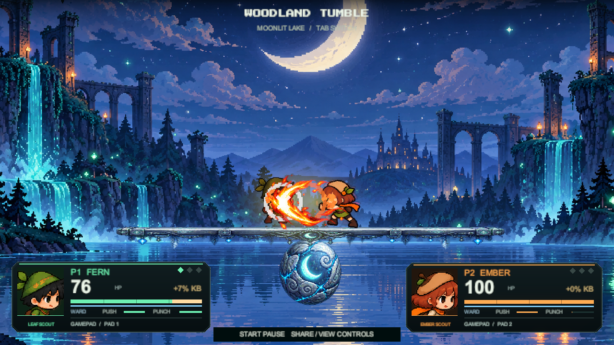
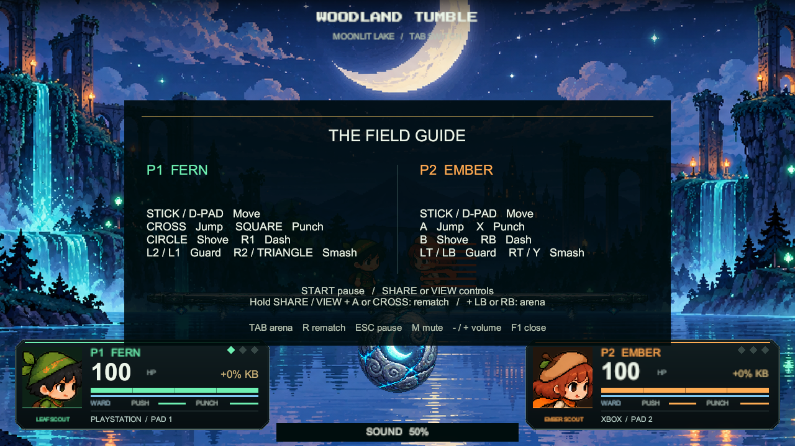

# Woodland Tumble

A local two-player woodland balance brawler for **Unity 6000.5.10f1, Universal 2D / URP 2D**.

Open `Assets/Scenes/WoodlandTumble.unity`. The camera, arena, player prefab instances and HUD are saved in this scene and are visible and editable outside Play Mode. If you already had the old scene open during the update, refresh the project and reopen the scene once.

## Open in Unity

Use Unity Hub's Add project from disk option and choose the folder containing Assets, Packages and ProjectSettings. Select Unity **6000.5.10f1**, open `Assets/Scenes/WoodlandTumble.unity`, press Play and click inside the Game view to give it input focus. On the development PC the folder is already updated; no pull is needed there.

## Controllers

PlayStation DualShock 4, Xbox One and other devices recognized as Unity Gamepads use the same physical button positions. This is controller support for the desktop Unity game, not a console executable. Connect the first pad for Fern and a second for Ember. Either player can still use their keyboard controls. Disconnecting a pad releases its input and preserves the other player's slot; a replacement fills the empty slot.

| Action | Xbox | PlayStation |
|---|---|---|
| Move | Left stick / D-pad | Left stick / D-pad |
| Jump / double jump | A | Cross |
| Punch / combo | X | Square |
| Shove / combo | B | Circle |
| Guard / parry | LT or LB | L2 or L1 |
| Dash | RB | R1 |
| Hold / release smash | RT or Y | R2 or Triangle |
| Pause / resume | Menu / Start | Options |
| Show / hide controls | Release View | Release Share |
| Restart match | Hold View + A | Hold Share + Cross |
| Previous / next arena | Hold View + LB / RB | Hold Share + L1 / R1 |

The field guide and device labels update for each assigned pad. Menu shortcuts suppress the corresponding gameplay button. Unplugging while charging cancels the charge. The ordinary HID joystick fallback has no guaranteed button mapping; see [Unity's supported gamepad layouts](https://docs.unity3d.com/Packages/com.unity.inputsystem@1.19/manual/Gamepad.html). Physical USB/Bluetooth behavior still needs a check with your own controller.

## Play

| Action | Fern / Player 1 | Ember / Player 2 |
|---|---|---|
| Move | A / D | Left / Right |
| Jump / double jump | W, then W again in the air | Up, then Up again in the air |
| Block | Hold S | Hold Down |
| Dash | Left Shift | Right Shift |
| Charged smash | Hold and release H | Hold and release J |
| Push | F | K |
| Punch | G | L |
| Controls overlay | F1 | F1 |
| Mute / effect volume | M / minus / equals | M / minus / equals |
| Pause | Escape | Escape |
| Restart match | R | R |
| Next arena | Tab | Tab |
| Select arena | 1 / 2 / 3 | 1 / 2 / 3 |

Face your rival and get close. Push deals **12 base damage**; punch deals **16**. Confirmed hits can chain into a three-hit combo with F/G or K/L. Press the next attack during the current attack to buffer it. The third confirmed hit deals 1.4 times its normal damage. The chain expires if no hit connects for 1.05 seconds.

Each landing restores one extra aerial jump. Dash gives a short burst followed by an 0.85-second cooldown. Hold smash to build power, then release; a full charge releases automatically after 0.85 seconds. Charging blocks ordinary attacks, jumping and dashing.

Block faces the direction your scout is looking, so attacks from behind still hurt. Raising guard needs at least 20 shield. Holding it drains shield, and absorbed hits drain more. A hit within the first 0.12 seconds of a fresh guard is parried and staggers the attacker. Parry has a 0.45-second rearm delay. An empty shield causes a 1.25-second guard break before recovery can begin.

Damage makes later knockback stronger. Empty health or falling off the plank loses the round. First to three rounds wins.

Use **Tab** or **1 / 2 / 3** to change between **Sunlit Hollow**, **Moonlit Lake** and **Ember Grove**. Each has a different background, ball and plank appearance. They share the same collision layout and balance physics.

## Download

[Unity source ZIP](https://github.com/Zeref538/woodland-tumble/releases/download/v5.0.0/Woodland-Tumble-Unity-v5.zip) contains the full editable project. Extract it, then add the woodland-tumble folder through Unity Hub. It does not include Library or build output.

[Artwork-only ZIP](https://github.com/Zeref538/Woodland-Scouts/releases/download/tumble-art-v5.0.0/Woodland-Tumble-art-v5.zip) is about 17 MB and contains the individual frames plus arena images.

## Clone and update

Install Git and Unity **6000.5.10f1** through Unity Hub. Clone once, then add the downloaded project folder in Unity Hub and open `Assets/Scenes/WoodlandTumble.unity`.

**macOS Terminal:**

```sh
cd ~/Desktop
git clone https://github.com/Zeref538/woodland-tumble.git
cd woodland-tumble
```

**Windows PowerShell:**

```powershell
cd $HOME
git clone https://github.com/Zeref538/woodland-tumble.git
cd woodland-tumble
```

To inspect new changes without applying them, run these commands inside the project folder:

```sh
git status --short
git fetch origin
git log --oneline HEAD..origin/main
```

To apply the latest version, stop Play Mode and close Unity, then run:

```sh
git pull --ff-only
```

Reopen the project after the update. If Git reports local changes or a merge conflict, keep your work and resolve that first. Do not use `reset --hard` to force the update. `--ff-only` refuses an update that would require merging separate local commits.

## Edit the game

- **Arena:** expand `Environment - Edit These Objects`. Select the background, Mossbound Oak Plank or Runewood Balancing Sphere. Edit Transform, SpriteRenderer and the plank's BoxCollider2D/HingeJoint2D in the Inspector. The flat walking collider deliberately excludes decorative mushrooms and vines.
- **Starting positions:** move the two objects under `Spawn Points`. Their gizmos show each player's collision footprint. The Scout component's Spawn Point field connects each player to its marker.
- **Characters:** scene players are prefab instances of `Assets/Prefabs/Fern.prefab` and `Ember.prefab`. Their Character child contains SpriteRenderer and Animator. Keep character roots at scale 1 for the supplied collider proportions.
- **Animation:** select the Character child and open Unity's Animation window. Choose the action clip to edit its sprite keyframes. Block, DoubleJump, Dash, Charge, Smash, Combo2 and Combo3 are separate editable states alongside Walk, Jump, Hurt, Push, Punch and Knockout. Clips and controllers are in `Assets/Animations/Fern` and `Ember`. The original actions contain ten separate frame sprites; special-action clips use the two scouts' distinct sprite sets. Knockout holds its final collapsed pose. Idle uses the first standing frame. The Frames asset is a catalog of source sprites; playback comes from the animation clips.
- **Sprites:** `Assets/Art/Characters/<Fern or Ember>/<Action>/01.png` through `10.png`. Each PNG imports as a **Single** sprite, **Full Rect**, 160 pixels per unit, Point filtering, no compression or mipmaps. All canvases are 256×256 with a common foot pivot (128, 24 pixels from the bottom). The complete outlines are extracted before alignment; the runtime does not cut a grid from a large sheet.
- **Combat tuning:** select a player's root and edit max health, push/punch damage, knockback, range and cooldown on Scout. Select Woodland Game to edit rounds to win, fall boundary and plank restoring force.
- **Text and panel design:** expand `HUD - Arena Broadcast`. The compact fighter plates, cropped portraits, health numbers, ward strips and control overlay are editable UI objects. F1 opens the full controls without pausing. The footer shows sound changes; M and minus/equals also work while paused. Health fills ease toward their values, with delayed damage trails. The shaped fighter plate is `Assets/Art/UI/ScoutPlate.png`; its corner cuts and fine rim are authored in GameSetup. The portrait, device row and quarter-marked health fill remain separate editable objects. The HUD component's Fern Color and Ember Color control the live player panel accents. Health, cooldowns, names and scores update from game state. The Press Start 2P font and OFL license are in `Assets/Fonts`.
- **Effects:** select `Effects - Trails and Splashes` to tune intensity, trail duration, shake, footsteps and particle gravity, or toggle ambient fireflies and camera shake. Effects include elemental hit bursts, guard impacts, parry flashes, aerial-jump rings, dash trails, charged smash bursts, attack arcs, jump/landing dust, footstep leaves, knockout stars and victory bursts. Sixteen transparent slash frames animate mint leaves for Fern and amber flames for Ember. White impact cores, restrained bloom, tapered afterimages and damped camera impulses reinforce contact. Brief hit pauses emphasize confirmed attacks. A shared 320-sprite pool bounds active effects; pausing freezes their animation. Thirteen licensed action sounds use eight pooled voices with a saved master volume and mute setting. See [audio sources and event mapping](Documentation/AUDIO.md).

`Woodland > Rebuild Editable Demo Scene` restores the supplied demo layout, clips and prefabs; it overwrites custom demo edits, so use it only when you want to reset. Backups of the previous scene are under `Documentation/Backups`. `Woodland > Validate Editable Game` runs a temporary Play Mode check and returns to edit mode; it saves its report and previews under Documentation.

## Edge physics

Players use the zero-friction PlayerSlide physics material, and the plank has slightly rounded collision corners. Ground traction is applied along the plank's top surface and compensates for its tilt and motion. Side faces, corners facing sideways and the opposing player do not count as ground. Air steering does not stop falling or cancel horizontal momentum when movement keys are released. This avoids the old wall-friction hang at plank ends while keeping controlled movement on top.

## Art and validation

Character frames use transparent, aligned canvases. The game plays native editable Unity animation clips rather than cutting a sheet during gameplay. Original artwork sources remain under `Assets/Art/Sources`.

The controller and presentation update passed **265 Play Mode checks in Unity 6000.5.10f1**. Tests cover combat, six edge-collision cases, animations, both players' actions, VFX, text fit and audio. Virtual controllers exercise separate player slots, movement, attacks, jump, guard, dash, charge, unplug/reconnect, pause, help, arena changes and rematch. Additional checks verify that unplugging or entering the menu cancels a held charge without firing. The field guide is captured with virtual PlayStation and Xbox layouts and their actual labels.

The v5 Windows build succeeded. Physical controller USB/Bluetooth behavior, physical keyboard play and subjective headphone balance still need a local check. All automated sound tests stay silent. The virtual-device fixture is controlled testing, not two-person hardware playtesting.

Full results: [Play Mode report](Documentation/PLAYMODE-VALIDATION-v5.json), [build record](Documentation/BUILD-v5.json) and [validation notes](Documentation/VALIDATION.md). Unity still logs its internal QuickSearch startup exception separately from the completed game checks.





[Moonlit Lake](Documentation/arena-1-1280-v5.png) | [Guard](Documentation/combat-guard-1280-v5.png) | [Combo](Documentation/combat-combo-1280-v5.png)

Artwork is also available separately in [Woodland-Scouts/tumble](https://github.com/Zeref538/Woodland-Scouts/tree/main/tumble). It includes 160 individual character frames, three backgrounds, three planks, three spheres and 16 elemental slash frames. The new Block and DoubleJump animations add 40 distinct sprites; the other special actions use dedicated native clips based on each character's existing poses.

Public repository: [Zeref538/woodland-tumble](https://github.com/Zeref538/woodland-tumble). GitHub setup and lab-computer sign-out guidance are in [Documentation/GITHUB.md](Documentation/GITHUB.md).
