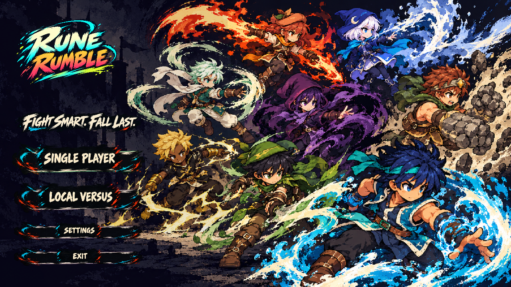
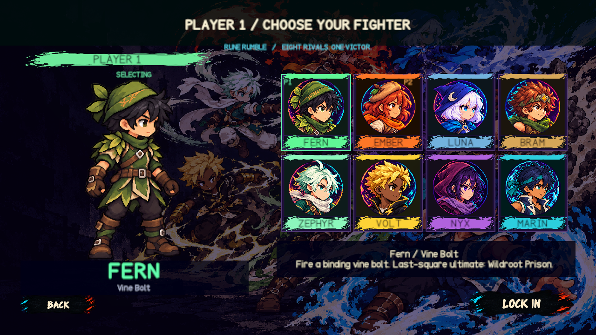
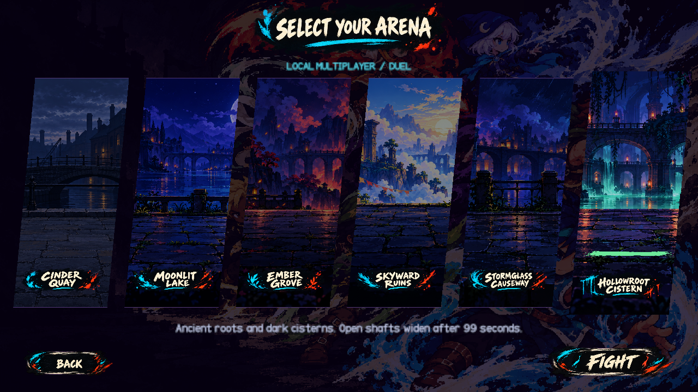

# Rune Rumble

## Pasuntok Nga! assignment package

The separate Filipino punch edition is in `Assets/Scenes/PasuntokNga.unity`. Its Windows player is `Build/PasuntokNga/PasuntokNga.exe`, and its portable submission archive is `Build/Submission/Pasuntok-Nga-John-Andrei-M-Martinez-Display-Fix.zip`. Extract the complete archive and launch the EXE inside; the runtime files must stay beside it. Build outputs are local and excluded from Git.

This edition disables jumping, replaces kicks with grounded uppercuts, sends traveling fists for ranged punches and uses short-range three-hit punch barrages. Its title credits John Andrei M. Martinez. The original Rune Rumble scene and Windows build remain separate.

The user's selected rules still differ from the exam's strict straight-punch-only requirement. The fantasy environments, hit meters and knockdown behavior also remain rubric exceptions. Software input tests do not establish real controller feel or clean-machine compatibility. See [the Filipino delivery report](Documentation/Filipino-v20/DELIVERY.json).

Rebuild using `GameSetup.PrepareFilipino`, validate using `GameValidation.RunFilipino`, build with `GameSetup.BuildFilipinoWindows`, and package with `python Tools/package_filipino.py`.

A local 2D ring-out fighter for Unity 6000.5.10f1 with eight detailed pixel-art fighters and six grounded arenas. The interface uses illustrated black-ink controls with character-colored ink effects.

## Fight for the edge

Five confirmed hits knock a fighter down for 4.5 seconds. Tap X (P1 keyboard), N (P2 keyboard), or the controller X button to get up earlier, with a 2.1-second minimum. Push them into an open manhole to win the round. Getting up restores all five hit squares. Damage alone does not end a round.

After 99 seconds, both holes widen and the safe floor shrinks until someone falls. First to three rounds wins. There is no balance mode or online multiplayer.

Punches start quickly. Kicks take longer. A missed or blocked attack leaves recovery time when the rival can punish it. Only confirmed punch, punch, kick earns the finisher; repeated punches, misses and blocked hits cannot build it. Guard faces forward, costs 3 stamina per second, and displays a six-frame elemental shield. Fresh guards can parry, and grabs counter guarding. Ranged specials travel up to 14.4 world units and display CLANG! on shield contact. Press special again, guard, punch or kick before discharge to cancel a charge; its initial stamina cost is still spent. Opponent melee hits also interrupt charging and the pre-projectile cast. Air punches and kicks use the same inputs. Air specials charge in 0.28 seconds instead of 0.85 and aim once toward the opponent at release, with a limited vertical angle and no tracking afterward. Confirmed hits display rotating comic words and a combo count; misses, blocks and incoming hits break that displayed streak. A moving ink highlight marks a ready ultimate. The CPU responds to sustained pressure and exposed recovery.

## Play

Open this folder in Unity Hub using **Unity 6000.5.10f1**. Open `Assets/Scenes/WoodlandTumble.unity`, then press **Play**. Choose **Single Player** for a CPU rival or **Local Versus** for two players.

The Windows build, when built locally, is `Build/Windows/RuneRumble.exe`. Build outputs are not tracked in Git.

| Action | P1 keyboard | P2 keyboard | PlayStation | Xbox |
|---|---|---|---|---|
| Move | A / D | Left / Right | Stick / D-pad | Stick / D-pad |
| Jump / double jump | W | Up | Up | Up |
| Punch | T | I | Square | X |
| Kick | Y | O | Circle | B |
| Hold guard | S | Down | Cross / L2 | A / LT |
| Charged special | G | K | Triangle | Y |
| Backstep | Q | U | L1 | LB |
| Dash | E | P | R1 | RB |
| Last-segment ultimate | H | L | Both triggers | Both triggers |
| Grab | F | J | Keyboard | Keyboard |
| Pause | Escape | Escape | Options | Menu |
| Move list | F1 | F1 | Release Share | Release View |

The action circles also accept mouse input. Menu navigation supports arrows, stick, Enter or the controller's South button. Physical controller feel still needs a two-person playtest; software input fixtures cannot establish that.

## Roster and arenas

Fern uses vines, Ember fire, Luna frost, Bram earth, Zephyr wind, Volt lightning, Nyx shadow and Marin tides. Each has its own native sprite catalog, ranged special and last-segment ultimate. Character size comes from one uniform scale and a calibrated foot pivot, never separate horizontal and vertical stretching. Each idle now has six breathing poses in a ten-frame loop. Idle artwork is calibrated against the combat pose's head size and body height, with stationary foot anchors.

Character selection uses detailed pixel-art poses with a four-pose breathing loop and dedicated face portraits. The active fighter appears on the left for either player.

The arenas are Cinder Quay, Moonlit Lake, Ember Grove, Skyward Ruins, Stormglass Causeway and Hollowroot Cistern. Scenery, fixed collision, manholes, fighters, effects and HUD remain separate layers.

The camera moves closer for large fighters and pulls back for separation, jumps and edge falls. Physical collision shapes keep their existing dimensions.

## Edit and verify

`Assets/Editor/GameSetup.cs` rebuilds the editable scene and builds Windows. Menu callbacks are attached in `WoodlandHUD.Awake`, so they still work after reloading the saved scene.

Use Unity batch mode with `-projectPath` pointing to this folder and `-executeMethod` set to one of these methods:

- `GameSetup.Prepare`: rebuild the scene from the current art and catalogs.
- `GameValidation.RunDuelSaved`: test the saved scene and capture the current presentation.
- `GameValidation.RunCounterplay`: test recovery, guarding and confirmed combo routes.
- `GameValidation.RunMidtermCombat`: test guard costs, knockdown drift, Volt rush and long-range hits.
- `GameValidation.RunDuelFresh`: rebuild the current HUD and verify the saved scene.
- `GameSetup.BuildWindows`: build the Windows player.

Add `-silent-test` for muted verification and `-logFile` for a log. Use `-quit` with Prepare and BuildWindows. The validation methods close Unity themselves after writing their JSON reports.

Current combat verification passed 333 checks for ten comic hit words, combo display, all eight aerial kits and special interruptions. The suite includes real jumps under gravity and verifies that interrupted casts cannot emit delayed projectiles. See [current delivery evidence](Documentation/DELIVERY-v19.json) and [TODO.md](TODO.md). Earlier sprite-binding, scene and contact reports are retained as historical evidence. These checks do not replace a physical two-player/controller playtest. The design and import calibrations live in [DESIGN.md](DESIGN.md) and [art direction](Documentation/ART-DIRECTION.md).

The original Rumble Display, Rumble Signal and Rumble Read typefaces cover headers, subheaders/numbers and body text. Their editable vector source is Tools/create_rumble_fonts.py.
