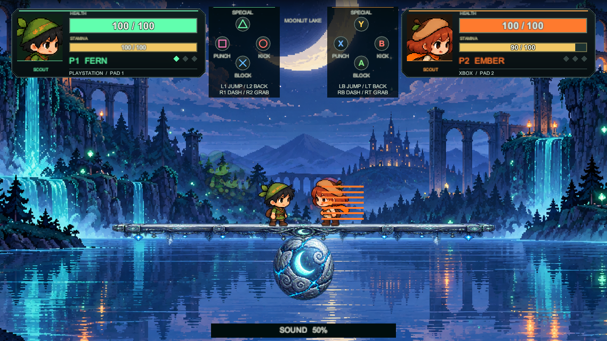
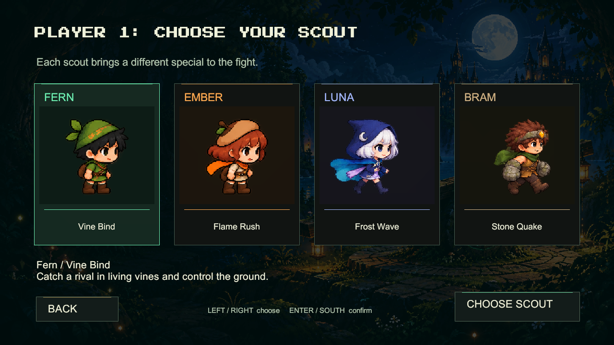
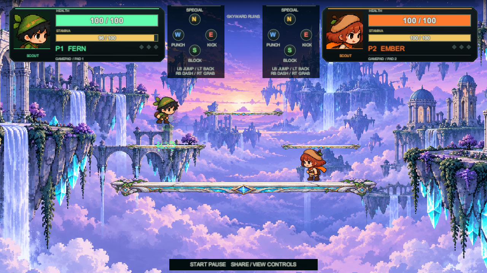

# Wildwood Rivals

A fantasy pixel-art fighting game for **Unity 6000.5.10f1, Universal 2D / URP 2D**. The existing repository and scene retain their woodland-tumble names.

## Open on this PC

The local project is already updated. In Unity Hub, choose **Add project from disk** and select this folder. Open `Assets/Scenes/WoodlandTumble.unity`, press Play and use the main menu.

```powershell
& "C:\Program Files\Unity\Hub\Editor\6000.5.10f1\Editor\Unity.exe" -projectPath "C:\Users\johna\OneDrive\Documents\Portfolio\GameDev\woodland-tumble"
```

## Choose a match

**Single Player** plays against a CPU rival. **Multiplayer** supports two local players using keyboards or controllers. Choose **Arena PVP** for fixed platforms or **Balance** for the tilting plank, then choose characters and one of four maps. This is local play, not online multiplayer.

| Scout | Special | Character |
|---|---|---|
| Fern | Vine Bind | Green scout who roots and slows a rival after contact |
| Ember | Flame Rush | Amber scout with a forward two-hit lunge |
| Luna | Frost Wave | Moon mage with a traveling wave that slows on contact |
| Bram | Stone Quake | Gauntlet fighter whose grounded slam launches nearby rivals |

Each scout has an independent sprite catalog and native Unity animation controller. Specials consume stamina on release. Bram must be grounded. Solo mode picks a different CPU character automatically; local players select their characters in turn.

Maps: **Sunlit Hollow**, **Moonlit Lake**, **Ember Grove**, **Skyward Ruins**. Each changes the background, plank and balancing sphere. Arena PVP adds three fixed ledges and hides the sphere.

## Controls

The HUD shows the assigned controller's face buttons. Connect one pad for player one and another for player two. The game accepts Unity Gamepad devices, including DualShock 4 and Xbox One layouts. This is a desktop game, not a PlayStation or Xbox console build.

| Action | PlayStation | Xbox | P1 keyboard | P2 keyboard |
|---|---|---|---|---|
| Move | Stick / D-pad | Stick / D-pad | A / D | Left / Right |
| Punch / combo | Square | X | G | L |
| Kick / combo | Circle | B | F | K |
| Hold block / parry | Cross | A | S | Down |
| Hold / release special | Triangle | Y | H | J |
| Jump / double jump | L1 | LB | W | Up |
| Backstep | L2 | LT | Q | U |
| Dash | R1 | RB | Left Shift | Right Shift |
| Grab & toss | R2 | RT | E | O |
| Pause | Options | Menu | Escape | Escape |
| Controls | Release Share | Release View | F1 | F1 |

Hold Share / View with South to rematch, or with L1/R1 or LB/RB to change maps. These shortcuts suppress the matching gameplay input. Tab changes maps, R restarts, M mutes, and minus/equals adjust volume. Menus accept pointer clicks, arrows/stick and Enter/South. Menu and match input are kept separate.

Health reaches zero or falling below the arena loses the round. First to three rounds wins. Confirmed punches and kicks can chain into three-hit combos; a buffered follow-up runs after recovery. Block faces forward, drains stamina and can break. A fresh guard can parry. Grab counters a frontal guard. Backstep briefly avoids hits.

The two meters are health and real shared stamina. Jump costs 4, aerial jump 6, kick 6, punch 8, dash 10, Backstep 12, special 14 and Grab & Toss 18. Failed actions do not spend stamina. It regenerates after a short recovery delay. Attacks, guard and mobility compete for this same resource.

**Settings** adjusts sound volume, fullscreen, camera shake and effect intensity. Sound volume, mute, shake and effect intensity persist between sessions. Exit closes the standalone game; in the Editor it stops Play Mode.

## Clone and update

Install Git and Unity **6000.5.10f1** through Unity Hub. Clone once, then add the downloaded project folder in Unity Hub and open `Assets/Scenes/WoodlandTumble.unity`.

**macOS Terminal:**

```sh
cd ~/Desktop
git clone https://github.com/Zeref538/woodland-tumble.git
cd woodland-tumble
```

**Windows PowerShell:**

```powershell
cd $HOME
git clone https://github.com/Zeref538/woodland-tumble.git
cd woodland-tumble
```

To inspect new changes without applying them, run these commands inside the project folder:

```sh
git status --short
git fetch origin
git log --oneline HEAD..origin/main
```

To apply the latest version, stop Play Mode and close Unity, then run:

```sh
git pull --ff-only
```

Reopen the project after the update. If Git reports local changes or a merge conflict, keep your work and resolve that first. Do not use `reset --hard` to force the update. `--ff-only` refuses an update that would require merging separate local commits.

## Editable project

The saved scene contains the camera, arena, player prefab instances and native HUD. Edit `Environment - Edit These Objects`, `Players - Editable Prefab Instances` and `HUD - Arena Broadcast` in the Hierarchy. Character assets live under `Assets/Art/Characters/{name}` and native clips under `Assets/Animations/{name}`.

There are **360 individual character frames**. Most canvases are 256 x 256. Special frames are 384 x 256 so magic does not shrink the body. Every canvas shares a foot pivot 24 pixels above the bottom. Sources and extraction measurements are retained in `Assets/Art/Sources` and [the roster manifest](Documentation/ROSTER-ART-v6.json). No character references another character's sprite files.

`Woodland > Rebuild Editable Demo Scene` restores the supplied layout and overwrites custom demo edits. Menu callbacks bind when the game starts so they survive scene reloads. `Woodland > Validate Editable Game` runs the controlled Play Mode fixture. Audio sources and licensing are in [Documentation/AUDIO.md](Documentation/AUDIO.md).

## Download and verification

The final scene passed **454 Play Mode checks** in Unity 6000.5.10f1. The same 454 checks passed again after the crystal-prop crop correction. The [Play Mode report](Documentation/PLAYMODE-VALIDATION-v6.json) records each assertion. The Windows build succeeded. Physical controller USB/Bluetooth play and subjective headphone balance still require a local check. Automated tests remain silent.

[Full Unity source ZIP](https://github.com/Zeref538/woodland-tumble/releases/download/v6.0.0/Wildwood-Rivals-Unity-v6.zip) includes Assets, Packages and ProjectSettings without Library or executable output.







Artwork downloads are separate in [Woodland-Scouts/tumble](https://github.com/Zeref538/Woodland-Scouts/tree/main/tumble), useful for the lab's slow Wi-Fi.

Public repository: [Zeref538/woodland-tumble](https://github.com/Zeref538/woodland-tumble).
