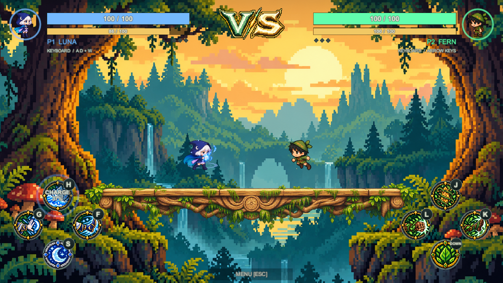
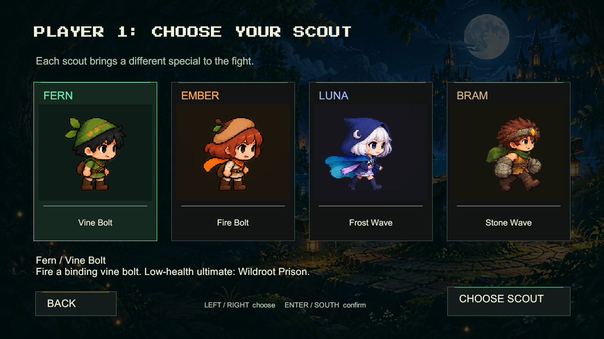
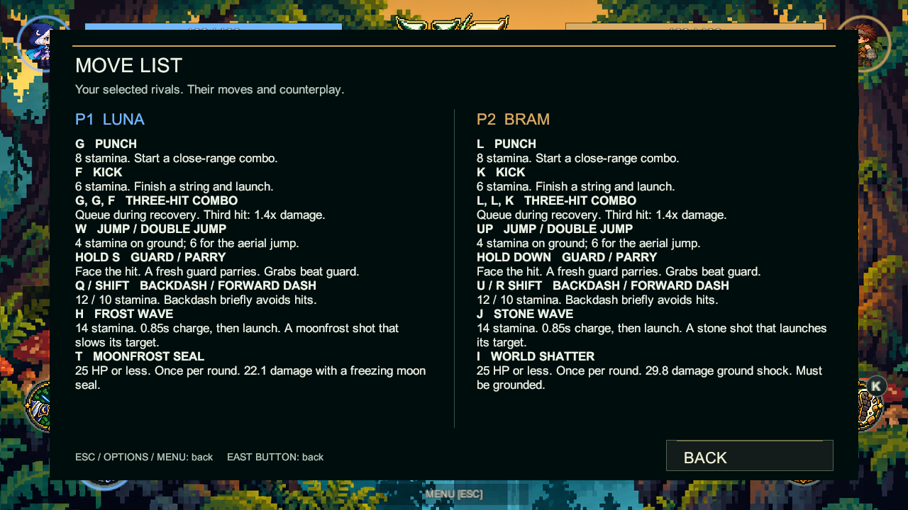
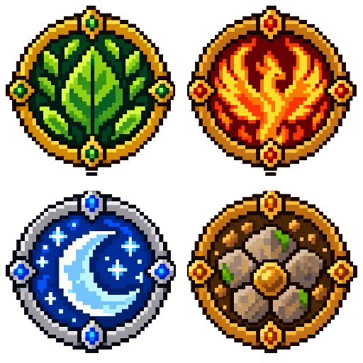

# Tilt Rivals

A fantasy pixel-art fighting game for **Unity 6000.5.10f1, Universal 2D / URP 2D**. The existing repository and scene retain their woodland-tumble names.

## Open on this PC

The local project is already updated. In Unity Hub, choose **Add project from disk** and select this folder. Open `Assets/Scenes/WoodlandTumble.unity`, press Play and use the main menu.

```powershell
& "C:\Program Files\Unity\Hub\Editor\6000.5.10f1\Editor\Unity.exe" -projectPath "C:\Users\johna\OneDrive\Documents\Portfolio\GameDev\woodland-tumble"
```

## Choose a match

**Single Player** plays against a CPU rival. **Multiplayer** supports two local players using keyboards or controllers. Choose **Arena PVP** for fixed platforms or **Balance** for the tilting plank, then choose characters and one of four maps. This is local play, not online multiplayer.

| Scout | Ranged special | Low-health ultimate |
|---|---|---|
| Fern | Vine Bolt: roots and slows | Wildroot Prison |
| Ember | Fire Bolt: stronger flame contact | Phoenix Combo |
| Luna | Frost Wave: slows on contact | Moonfrost Seal |
| Bram | Stone Wave: launches on contact | World Shatter |

Each scout has an independent sprite catalog and native Unity animation controller. Ranged specials spend 14 stamina to begin a visible 0.85-second charge, then launch automatically. There is no ranged cooldown; charging and cast recovery prevent overlapping casts. A hit cancels the wind-up. Ultimates unlock at 25 health or below, can be used once per round and have a visible windup that allows counterplay. Bram's ultimate requires the ground. Solo mode picks a different CPU character automatically; local players select their characters in turn.

Maps: **Sunlit Hollow**, **Moonlit Lake**, **Ember Grove**, **Skyward Ruins**. Arena PVP uses one illustrated 14-unit base with no overhead ledges. Balance retains its original tilting board and sphere. Artwork scales uniformly.

## Controls

The HUD shows the assigned controller's face buttons. Connect one pad for player one and another for player two. The game accepts Unity Gamepad devices, including DualShock 4 and Xbox One layouts. This is a desktop game, not a PlayStation or Xbox console build.

| Action | PlayStation | Xbox | P1 keyboard | P2 keyboard |
|---|---|---|---|---|
| Move | Stick / D-pad | Stick / D-pad | A / D | Left / Right |
| Punch / combo | Square | X | G | L |
| Kick / combo | Circle | B | F | K |
| Hold block / parry | Cross or L2 | A or LT | S | Down |
| Charged ranged special | Triangle | Y | H | J |
| Jump / double jump | D-pad Up / stick Up | D-pad Up / stick Up | W | Up |
| Backstep | L1 | LB | Q | U |
| Dash | R1 | RB | Left Shift | Right Shift |
| Low-health ultimate | L2 + R2 together | LT + RT together | T | I |
| Grab & toss | Keyboard only | Keyboard only | E | O |
| Pause | Options | Menu | Escape | Escape |
| Controls | Release Share | Release View | F1 | F1 |

Hold Share / View with South to rematch, or with L1/R1 or LB/RB to change maps. These shortcuts suppress the matching gameplay input. Tab changes maps, R restarts, M mutes, and minus/equals adjust volume. Menus accept pointer clicks, arrows/stick and Enter/South. Menu and match input are kept separate.

Health reaches zero or falling below the arena loses the round. First to three rounds wins. Confirmed punches and kicks can chain into three-hit combos; a buffered follow-up runs after recovery. Block faces forward, drains stamina and can break. A fresh guard can parry. Grab counters a frontal guard. Backstep briefly avoids hits.

Try Square, Square, Circle (Xbox X, X, B) for punch, punch, kick. Early grounded hits keep the rival close; the third hit deals 1.4 times normal damage and knocks them away. Each character has new six-frame hit effects and separate six-frame finisher effects. Misses and blocked hits give no combo credit.

The two meters are health and real shared stamina. Jump costs 4, aerial jump 6, kick 6, punch 8, dash 10, Backstep 12, special 14 and Grab & Toss 18. Failed actions do not spend stamina. It regenerates after a short recovery delay. Attacks, guard and mobility compete for this same resource.

**Settings** adjusts sound volume, fullscreen, camera shake and effect intensity. Sound volume, mute, shake and effect intensity persist between sessions. Exit closes the standalone game; in the Editor it stops Play Mode.

For offline USB installation, read [OFFLINE-SETUP.md](OFFLINE-SETUP.md). For Mac lab editing, read [HANDOFF.md](HANDOFF.md): editor version, controls, safe branches and checks. The lab editor 6000.2.2f1 is older than this project; downgrade compatibility is unverified.

## Clone and update

Install Git and Unity **6000.5.10f1** through Unity Hub. Clone once, then add the downloaded project folder in Unity Hub and open `Assets/Scenes/WoodlandTumble.unity`.

**macOS Terminal:**

```sh
cd ~/Desktop
git clone --depth 1 --single-branch https://github.com/Zeref538/woodland-tumble.git
cd woodland-tumble
```

**Windows PowerShell:**

```powershell
cd $HOME
git clone --depth 1 --single-branch https://github.com/Zeref538/woodland-tumble.git
cd woodland-tumble
```

To inspect new changes without applying them, run these commands inside the project folder:

```sh
git status --short
git fetch origin
git log --oneline HEAD..origin/main
```

To apply the latest version, stop Play Mode and close Unity, then run:

```sh
git pull --ff-only
```

Reopen the project after the update. If Git reports local changes or a merge conflict, keep your work and resolve that first. Do not use `reset --hard` to force the update. `--ff-only` refuses an update that would require merging separate local commits.

## Editable project

The saved scene contains the camera, arena, player prefab instances and native HUD. Edit `Environment - Edit These Objects`, `Players - Editable Prefab Instances` and `HUD - Arena Broadcast` in the Hierarchy. Character assets live under `Assets/Art/Characters/{name}` and native clips under `Assets/Animations/{name}`.

There are **522 individual character frames**, including dedicated neutral Idle poses for Luna and Bram. Ordinary frames are 256 x 256. Special, Dash, Backstep, Victory and Ultimate frames are 384 x 256 so effects do not shrink the body. Every canvas shares a foot pivot 24 pixels above the bottom. Original sheets are retained in [the separate artwork repository](https://github.com/Zeref538/Woodland-Scouts/tree/main/tumble/sources), with extraction measurements in [the v7 roster manifest](Documentation/ROSTER-ART-v7.json). No character references another character's sprite files.

`Woodland > Rebuild Editable Demo Scene` restores the supplied layout and overwrites custom demo edits. Menu callbacks bind when the game starts so they survive scene reloads. `Woodland > Validate Editable Game` runs the controlled Play Mode fixture. Audio sources and licensing are in [Documentation/AUDIO.md](Documentation/AUDIO.md).

## Download and verification

The current v8.1 scene passed **112 combat, presentation and replay checks** in Unity 6000.5.10f1. See [the assertion report](Documentation/PLAYMODE-VALIDATION-v8.1.json), [28 combo checks](Documentation/MELEE-VALIDATION-v8.1.json) and [build evidence](Documentation/BUILD-v8.1.json). Older reports are historical. Physical controller USB/Bluetooth play and subjective headphone balance still need a local check. Automated playback stays silent.

[Full Unity source ZIP](https://github.com/Zeref538/woodland-tumble/releases/download/v8.1.0/Tilt-Rivals-Unity-v8.1.zip) includes Assets, Packages and ProjectSettings without Library or executable output. On John's existing PC, the project files are already updated locally; no pull is needed there.





[Smaller runtime artwork ZIP](https://github.com/Zeref538/Woodland-Scouts/releases/download/tumble-art-v8.0.0/Tilt-Rivals-runtime-art-v8.zip) omits the original source sheets. Artwork downloads are separate in [Woodland-Scouts/tumble](https://github.com/Zeref538/Woodland-Scouts/tree/main/tumble), useful for the lab's slow Wi-Fi.

Public repository: [Zeref538/woodland-tumble](https://github.com/Zeref538/woodland-tumble).

The combat HUD has small circular portraits showing the whole scout at the top corners, with player two mirrored to the right. The widened meters have precisely centered values. A larger VS emblem replaces the arena-name label. Health and stamina values stay inside their meter rails. The large panel backgrounds are removed. Each bottom corner has four 80-pixel action circles arranged as a diamond at the 1280x720 reference size.

Every action circle accepts pointer clicks through the same gameplay validation as its keyboard or controller action. Accepted actions pulse their own artwork and an expanding ring. Unavailable or paused actions flash red without spending stamina. Input badges follow the assigned device. The guard circle holds defense, and the ranged circle displays charge progress instead of a cooldown. Shoulder actions remain in F1 Controls. The center uses the illustrated VS mark; the sound-percentage popup is removed.

Each character has its own pixel-art action covers: leaves and vines for Fern, fire for Ember, moonlight and frost for Luna, and stone for Bram. The UI follows the selected character in either player slot.

## Match menu and move guide

Press **Esc** on keyboard, **Options** on PlayStation or the three-line **Menu** button on Xbox. Choose **Move List** from the paused menu. Both columns follow the selected scouts and their assigned devices, showing moves, costs, the three-hit combo, ranged charge timing and low-health ultimate rules. Back returns to the paused menu; Resume returns to combat. F1 remains a quick reference shortcut.

The game reads Unity's standard Gamepad controls rather than restricting gameplay to one controller model. The local fixture verified Sony's PS4 revision IDs 05C4 and 09CC, DualSense and Edge IDs 0CE6 and 0DF2, the shared Xbox XInput layouts and a generic gamepad fallback. These are software layout and description tests, not physical-device tests. Official pads and compatible third-party controllers still depend on the operating system and driver exposing a supported gamepad. See [Unity's supported devices](https://docs.unity3d.com/Packages/com.unity.inputsystem@1.19/manual/SupportedDevices.html).



## Combat corrections v8

Up now jumps and double-jumps on controllers. Hold Cross/A to guard; L2/LT also guards, while both triggers retain the ultimate chord. The pointer guard button releases on pointer-up, exit, lost focus, pause or menu changes. The three overhead PVP platforms are removed.

Melee effects follow the selected character rather than the player slot. Luna uses frost and Bram uses stone instead of inheriting Fern's green slash. Existing Punch/Kick artwork already belongs to each character and remains separate. Dash and combat trails use the fighter's actual sprite afterimages, with straight speed streaks removed.

Charged projectiles use a leaf lance, flame wings, an ice crescent or a segmented stone gauntlet. Ultimates add an animated character cut-in, its move name, background dimming, a brief impact tint and ghost afterimages. End, interruption, menu and pause restore the cinematic presentation.

Character art uses one uniform scale per character across every pose: Fern/Luna 160 pixels per unit, Ember 165 and Bram 151. These are modest visual calibrations; sprites are never stretched independently by axis. Both new idle poses retain a feet pivot 24 pixels above the bottom.

## Replay and lighter download v8.1

On the champion screen, press **Cross on PlayStation**, **A on Xbox** or **R on keyboard** to play again. Cross/A still guards during combat. All attack damage is 15 percent lower: a base punch deals 13.6 and a base kick deals 10.2 before action modifiers. Four distinct chunky pixel shields now cover the guard buttons.



The source ZIP is **63,573,322 bytes**, 79.27 percent smaller than the previous release. The current project omits duplicate original art sheets and historical screenshots. Their verified copies remain in the artwork repository and older releases; see [archived artwork](Documentation/ARCHIVED-ART.md). Use the shallow clone command above to skip old Git history. A normal full-history clone still downloads the old objects.
